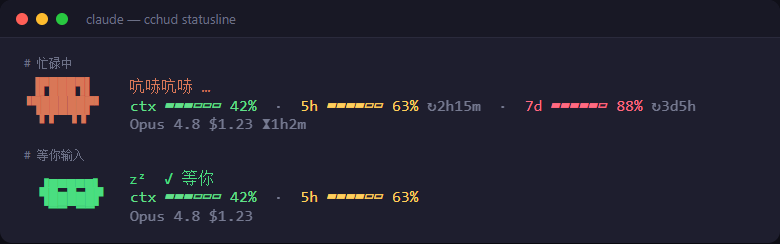

# cchud

> Claude Code 状态栏小兽 —— 一只会随状态切换姿势的像素小兽，外加上下文 / 用量 / 模型 / 花费一目了然。

`cchud` 是给 [Claude Code](https://claude.com/claude-code) 用的 `statusLine` 脚本。它从 stdin 读取 Claude Code 传入的会话 JSON，输出三行带颜色的终端状态栏。

## 效果



上图为同一脚本在六种状态下的实际输出：**思考中 / 跑命令 / 翻找文件 / 联网搜索 / 敲键盘**（橙色，小兽站立，头顶 badge 区分在干什么）与**等你输入**（绿色，小兽蜷缩低头打盹）。

显示内容：

- **小兽姿势 + 颜色 + 头顶 badge** —— 当前在干什么：思考 `?` / 跑命令 `>_` / 翻找 `⌕` / 搜索 `@` / 敲键盘 `I` / 等你 `zᶻ`，注册[实时状态源](#实时状态源hooks可选)后还有黄色的等确认 `!`。默认读会话日志的最后一个有意义事件推断（比看文件 mtime 更准，详见[状态推断的原理与限制](#状态推断的原理与限制)）；注册实时状态源后改由 hooks 即时驱动。
- **ctx** —— 上下文窗口占用百分比。
- **5h / 7d** —— 5 小时 / 7 天用量额度，带重置倒计时（`↻`）。
- **进度条颜色** —— 绿(<60%) / 黄(60-85%) / 红(≥85%)。
- **尾行** —— 待办完成数（`✓3/5`）、模型名、本次花费、累计时长，末尾是**会话名**（跨会话通信用的寻址代号，见[多会话辨识](#多会话辨识会话名--寻址代号)）。待办兼容两套机制:新版 **Task 系统**（`TaskCreate`/`TaskUpdate` 事件流，正序重放重建任务与状态）优先，没有再回落老版 **TodoWrite** 快照。此外若有「比主日志更新的活动子代理日志」（`<主会话id>/subagents/agent-*.jsonl`），优先取它的待办，否则用主会话自己的。

## 安装

需要本机有 [Node.js](https://nodejs.org/)（任意较新版本即可，脚本无依赖）。

把仓库克隆到任意位置：

```sh
git clone https://github.com/x-wink/cchud.git
```

然后编辑 `~/.claude/settings.json`，加入 `statusLine` 字段。

### macOS / Linux

```jsonc
{
  "statusLine": {
    "type": "command",
    "command": "/path/to/cchud/hud.sh",
    "refreshInterval": 2
  }
}
```

记得给启动器加可执行权限：`chmod +x /path/to/cchud/hud.sh`。

### Windows

直接用 `node` 调用 `hud.js`（注意 JSON 里反斜杠要转义）：

```jsonc
{
  "statusLine": {
    "type": "command",
    "command": "node \"C:\\path\\to\\cchud\\hud.js\"",
    "refreshInterval": 2
  }
}
```

保存后重启 Claude Code（或新开会话）即可生效。

## 提醒（可选）

`notify.js` 可在 Claude Code 需要你时弹**桌面通知 + 播提示音**，方便你挂着别的事时被叫回来。它借助 Claude Code 的两类钩子，并用不同提示音区分场景，凭声音即可分辨：

| 钩子           | 触发时机                       | 提示音（Windows）              |
| -------------- | ------------------------------ | ------------------------------ |
| `Stop`         | 答完、把控制权交还给你         | 前台提示音 `Windows Foreground.wav` |
| `Notification` | **卡住了，必须你操作才能继续** | 铃声 `Ring01.wav`              |

`Notification` 事件的具体事由（如「需要授权使用 Bash」）由 Claude Code 通过 stdin 的 `message` 给出，直接作通知正文。

只有**真正阻断流程**的 `Notification` 才会响（授权 / 选择 / 输入对话框），判定与状态栏的「等确认」同一套口径，见[什么算「等确认」](#什么算等确认)。其余一律静默——尤其是闲置提醒 `idle_prompt`：它在会话闲置到阈值（默认 75 分钟）时发出，文案是 "Claude is waiting for your input"，但那时候会话**已经答完并通知过你一次了**，再响一次铃只会让你白跑一趟。

跨平台：Windows 用 PowerShell WinRT Toast + 系统提示音，macOS 用 `osascript`，Linux 用 `notify-send` + `paplay`。

在 `settings.json` 里和 `statusLine` 同级加入 `hooks`（两类指向同一个脚本，脚本内部按事件类型自动区分）：

```jsonc
{
  "hooks": {
    "Stop": [
      { "hooks": [{ "type": "command", "command": "node \"C:\\path\\to\\cchud\\notify.js\"" }] }
    ],
    "Notification": [
      { "hooks": [{ "type": "command", "command": "node \"C:\\path\\to\\cchud\\notify.js\"" }] }
    ]
  }
}
```

通知标题里会带上项目名与会话名（见[多会话辨识](#多会话辨识会话名--寻址代号)），多个会话同时跑时一眼能认出是谁在叫你。Windows 上若通知没弹出，检查「设置 → 系统 → 通知」与「专注助手 / 勿扰模式」是否屏蔽了通知（提示音不受勿扰影响，仍会响）。

## pet-hook：Rust 版钩子写方（oxforge pet 桌宠共用）

`crates/pet-hook` 是 `state.js` 的 Rust 继任：同一口径、写同一个状态目录（`~/.cchud/state`，可经 `CCHUD_STATE_DIR` 或 `~/.cchud.json` 的 `stateDir` 改），`hud.js` 照读，
[oxforge-pet 桌宠](https://oxforge.xwink.fun/pet/) 也读它。它单文件、不依赖 Node、不往 stdout 写，跑在你的权限下，所以连同契约包 `crates/pet-state` 一起开源在这里。

```sh
cargo install --git https://github.com/x-wink/cchud pet-hook   # 或从 Releases 取平台二进制,改名为 pet-hook(.exe)放进 PATH
pet-hook setup            # 把九个事件的钩子幂等写进 ~/.claude/settings.json（写前备份 .bak）
pet-hook setup --dry-run  # 只看会改什么;--uninstall 只删自己加的;--settings <路径> 另指
```

`setup` 认 `CLAUDE_CONFIG_DIR`，会把旧的 `pet --hook` 注册换成自己的路径，别的钩子与键序原样保留。手工注册的等价写法见下一节，把 `state.js` 换成 `pet-hook` 的绝对路径即可。
已经注册着 `state.js` 的不用改：它发现本机有 `pet-hook`（`PET_HOOK` 环境变量、`PATH`、`~/.cargo/bin`）就整段委托给它，没有才自己写——两套写方只有一份口径。

## 实时状态源（hooks，可选）

默认的状态推断靠扫会话日志，受「落盘时机」限制——比如思考内容要整块结束才写入，思考期间状态栏拿不到任何新信息。`state.js` 提供另一条实时链路：注册为一组 Claude Code 钩子后，Claude Code 会在**事件发生的瞬间**同步调用它，它把「此刻在干嘛」写进 `~/.cchud/state/<会话id>.json`，`hud.js` 发现该文件后即优先采用（日志推断退为兜底）。收益：

- **按下回车立刻进入「思考中」**——不用等任何内容落盘；
- **工具执行前就切好姿态**——`PreToolUse` 带确切工具名，长命令全程姿态正确；
- **新增黄色「等确认 `!`」状态**——终端弹出必须你操作才能继续的交互（授权 / 选择 / 输入）时整只小兽变黄，这是日志推断给不了的。判定口径见[什么算「等确认」](#什么算等确认)。

在 `settings.json` 的 `hooks` 里把下列事件都指向 `state.js`（`Stop` / `Notification` 与 notify.js 并存，同一事件的 `hooks` 数组可以放多个命令）。全部加 `"async": true`：钩子在后台跑、完全不阻塞 Claude Code 主流程——代价是极小概率相邻事件写入乱序、状态短暂偏差，下个事件自然纠正，对状态展示这种「尽力而为」的用途是正确取舍：

```jsonc
{
  "hooks": {
    "UserPromptSubmit": [{ "hooks": [{ "type": "command", "command": "node \"C:\\path\\to\\cchud\\state.js\"", "async": true }] }],
    "PreToolUse":       [{ "hooks": [{ "type": "command", "command": "node \"C:\\path\\to\\cchud\\state.js\"", "async": true }] }],
    "PostToolUse":      [{ "hooks": [{ "type": "command", "command": "node \"C:\\path\\to\\cchud\\state.js\"", "async": true }] }],
    "SessionStart":     [{ "hooks": [{ "type": "command", "command": "node \"C:\\path\\to\\cchud\\state.js\"", "async": true }] }],
    "SessionEnd":       [{ "hooks": [{ "type": "command", "command": "node \"C:\\path\\to\\cchud\\state.js\"", "async": true }] }],
    "Stop": [
      { "hooks": [
        { "type": "command", "command": "node \"C:\\path\\to\\cchud\\notify.js\"" },
        { "type": "command", "command": "node \"C:\\path\\to\\cchud\\state.js\"", "async": true }
      ] }
    ],
    "Notification": [
      { "hooks": [
        { "type": "command", "command": "node \"C:\\path\\to\\cchud\\notify.js\"" },
        { "type": "command", "command": "node \"C:\\path\\to\\cchud\\state.js\"", "async": true }
      ] }
    ]
  }
}
```

细节与兜底（实现见 `state.js` / `hud.js` 的 `resolveState`）：

- 用户**中断 / 秒取消不触发任何钩子**，hook 状态会停在忙态。`hud.js` 用日志里的中断标记（比 hook 事件新即回休息）和 60 秒悬挂超时兜底，行为与纯日志推断一致。「等确认」同样过这道检查——ESC 掉授权对话框不发钩子，不兜底就会一直黄着。
- 状态文件比日志旧超过 10 分钟视为**钩子失联**（如中途卸载），自动退回日志推断；超过 24 小时的陈旧状态文件会被顺手清理。
- 状态目录可用 `stateDir` 配置（`CCHUD_STATE_DIR` / 配置文件同名字段）。

## 什么算「等确认」

黄色的「等确认 `!`」只有一个含义：**终端弹出了必须你操作才能往下走的交互，Claude 的流程被阻断在这里**。不阻断流程的通知一律不算。

Claude Code 的 `Notification` 钩子并不只在「需要你」时触发，它用 `notification_type` 区分事由。判定表（实现见 `config.js` 的 `notificationState`，`state.js` 与 `notify.js` 共用同一份，保证状态栏和提示音口径一致）：

| `notification_type`                          | 含义                     | 状态     | 响铃 |
| -------------------------------------------- | ------------------------ | -------- | ---- |
| `permission_prompt` / `worker_permission_prompt` | 授权对话框，**阻断**     | 等确认 🟡 | ✅   |
| `elicitation_dialog` / `elicitation_url_dialog`  | 输入对话框，**阻断**     | 等确认 🟡 | ✅   |
| `agent_needs_input`                          | 代理要你输入，**阻断**   | 等确认 🟡 | ✅   |
| `elicitation_response` / `elicitation_complete`  | 你已答复，阻断解除       | 思考中 🟠 | —    |
| `idle_prompt`                                | 闲置到阈值的提醒，不阻断 | 休息中 🟢 | —    |
| `auth_success` / `agent_completed` / `push_notification` / `computer_use_exit` | 杂项，与「谁在等谁」无关 | 不改变   | —    |

老版本 Claude Code 不带 `notification_type` 字段（那时 `Notification` 本就只在需要用户时触发），缺字段时视同「等确认」。

**`idle_prompt` 尤其要单独拎出来说**：它是会话闲置到阈值（`CLAUDE_CODE_IDLE_THRESHOLD_MINUTES`，默认 75 分钟）后发的提醒，文案就叫 "Claude is waiting for your input"——听起来像在等你，其实**恰恰是最闲的时候**，没有任何东西被阻断。把它算作「等确认」会让一类会话全程误报：你让 A 会话去指挥 B 会话干活，A 派完活就空等结果，闲够 75 分钟后整个等待期都停在黄色，而它本该是绿色的休息中。

「等确认」的退出同样靠钩子：你答复后的 `PostToolUse` / `elicitation_response` 会把状态推走。若你直接 **ESC 掉对话框**——这不触发任何钩子——`hud.js` 用 transcript 里的中断标记兜底回「休息中」（见 `resolveState`）。

## 多会话辨识（会话名 = 寻址代号）

多开会话时，尾行末尾显示**会话名**——就是 Claude Code 里跨会话通信用的那个代号，`Message from @xwink-console-7a`、`sent to xwink-console-7a`、`ListAgents` 里的名字，都是同一串：

```
✓3/5  ·  Opus 5 $1.23 ⧗2h  ·  xwink-console-7a
                              ~~~~~~~~~~~~~~~~
                                  会话名
```

来源是 `~/.claude/sessions/<pid>.json`（`CLAUDE_CONFIG_DIR` 生效）里的 `name`。**原样显示、不截断、不加任何前缀**——照着念能指认、复制出来就能直接给这个会话派活。

多会话协作时的典型用法：指挥会话要给某个终端派活，你把它状态栏上的名字念给指挥会话，它就能 `SendMessage` 过去。

**只显示自动派生的名字**（`xwink-console-7a` 这种「项目目录名 + 随机后缀」）。会话一旦有了自动标题或被 `/rename`，Claude Code 会把那个名字写进**终端标题栏**，状态栏再印一遍就是重复——那时尾行改回**项目名 + 会话短 id**（`xwink-console #0fb4082f`，会话 id 前 8 位 = UUID 第一段），代号照着标题栏念即可。

- 读不到会话名时（旧版 Claude Code、非 CLI 入口）也走这条回落。
- 打开 `sessionRef` 会补上 `ListAgents` 里的那截 ref：派生名后面跟 `cchud-96 [3bbce9]`，回落时则用它替掉短 id（`xwink-console [ed8eb7]`）。ref = `sha256("session:" + 该会话的 messaging socket 路径)` 的十六进制前 6 位，照抄 Claude Code 的算法算出来，同名会话靠它区分。
- 通知 toast 里则**总是带会话名**（超过 12 字截断）：toast 不在终端里，看不到标题栏。

各段都能单独关掉，见下方配置表的 `sessionName` / `sessionRef` / `projectName` / `sessionId` / `sessionIdLen`。

## 自定义称呼与文案

小兽的称呼、状态栏两种状态文本、通知标题/正文都可自定义。称呼默认为 **小螃蟹**。解析优先级：**CLI 参数 > 环境变量 > 配置文件 > 默认值**。

| 字段         | 默认值              | 用途                          |
| ------------ | ------------------- | ----------------------------- |
| `name`       | `小螃蟹`            | 称呼，用于通知标题里的 `{name}` |
| `busyLabel`  | `吭哧吭哧 …`        | 状态栏「忙碌」文本            |
| `idleLabel`  | `zᶻ  ✓ 等你`        | 状态栏「等你」文本            |
| `waitLabel`  | `等确认 …`          | 状态栏「等授权/等输入」文本（需注册[实时状态源](#实时状态源hooks可选)） |
| `doneTitle`  | `{name} · 等你了`   | 通知标题（答完）              |
| `doneBody`   | `答完了，回来看看 ✓`| 通知正文（答完）              |
| `needTitle`  | `{name} · 需要你`   | 通知标题（需要授权/等待输入） |
| `needBody`   | `需要你处理一下`    | 通知正文兜底（Claude 未给 message 时） |
| `sessionName`| `true`              | 尾行 / 通知标题是否显示会话名（见[多会话辨识](#多会话辨识会话名--寻址代号)） |
| `sessionRef` | `false`             | 会话名后是否再补一截 ref（`[3bbce9]`，同名会话消歧用） |
| `projectName`| `true`              | 取不到会话名时的回落：尾行显示项目目录名 |
| `sessionId`  | `true`              | 取不到会话名时的回落：尾行显示会话短 id |
| `sessionIdLen`| `8`                | 会话短 id 取前几位（2–36，默认 8 = UUID 第一段） |
| `sessionsDir`| `~/.claude/sessions`| Claude Code 活跃会话的登记目录（会话名与 ref 从这里读） |

**配置文件（推荐，一次配置两个脚本共用）**：把 `cchud.config.example.json` 复制为 `cchud.config.json`（脚本同目录）或 `~/.cchud.json`，按需修改。也可用 `--config <path>` 或环境变量 `CCHUD_CONFIG` 指定路径。

**命令行参数**（写进 `settings.json` 的 command 里）：

```jsonc
"command": "node \"C:\\path\\to\\cchud\\hud.js\" --name 大龙虾 --idle-label \"钳子等你~\""
```

**环境变量**：`CCHUD_NAME`、`CCHUD_BUSY_LABEL`、`CCHUD_IDLE_LABEL` 等（字段名大写下划线）。

## 状态推断的原理与限制

未注册[实时状态源](#实时状态源hooks可选)时，小兽的姿态通过**读取会话日志（transcript）的最后一个有意义事件**推断——而非看文件 mtime：

- assistant 调 `Bash` → 跑命令 `>_`；调 `Read/Grep/Glob` 等 → 翻找中 `⌕`；调 `WebSearch/WebFetch` → 搜索中 `@`；调 `Edit/Write` 等 → 敲键盘 `I`；仅思考或调其他工具 → 思考中 `?`；给出完整文字回复 → 休息中 `zᶻ`。
- 工具结果（`tool_result`）会被跳过、回溯到对应的工具调用判断姿态；中断标记 `[Request interrupted by user…]` 会被识别为「休息中」。
- 同一轮里「开场白文字」与随后的工具调用是**分开落盘**的两条记录：只有 `stop_reason` 为收尾（`end_turn`）的文字才算「答完 → 休息中」；若仍是 `tool_use`（或记录尚未写完），说明后面还要继续调工具，判为忙——避免长任务里开场白先落盘、工具调用还没落盘时**误判成休息**。

### 建议开启定期刷新（`refreshInterval`）

Claude Code 的状态栏默认**只在「有新助手消息」时刷新**——你**提交消息**这个动作本身不触发刷新。所以不加配置时，从你发消息到 Claude 开始响应的这段时间，状态栏会冻结在上一帧（看起来像「装睡」）。在 `statusLine` 里加上 `refreshInterval`（单位秒，最小 1）让它定期重绘即可解决（安装示例里已包含）。

### 已知限制（受 Claude Code 机制约束，非脚本能完全消除）

1. **短操作的姿态只会一闪而过**：assistant 消息要整条生成完才落盘，读一个文件、跑一条快命令这类毫秒级动作，对应姿态往往来不及显示。只有长任务（耗时命令、大范围检索）才会稳定停在对应姿态。
2. **「正在等待响应」与「提交后秒取消」无法即时区分**：Claude Code 取消时既不触发任何 hook，也不在日志留下可识别痕迹，两者的日志状态完全一致。为避免秒取消后**永久**卡在「思考中」，脚本采用兜底——一条用户输入悬挂超过 **60 秒**仍无任何响应跟进，即判定为已取消 / 久挂并回到「休息中」（`claude --resume` 回来也借此自愈）。代价是秒取消后需等这段时间才回休息；阈值在 `hud.js` 的 `IDLE_AFTER_MS` 可调。

## 调试

不接 Claude Code 时，可手动喂一段假 JSON 预览效果：

```sh
echo '{"context_window":{"used_percentage":42},"rate_limits":{"five_hour":{"used_percentage":63}},"model":{"display_name":"Opus 4.8"},"cost":{"total_cost_usd":1.23}}' | HUD_FAKE_STATE=busy node hud.js
```

环境变量 `HUD_FAKE_STATE=busy|idle|bash|read|web|edit|wait` 可强制小兽进入指定状态，方便调试。

模拟钩子事件验证实时状态源（`CCHUD_STATE_DIR` 可把状态文件指到临时目录）：

```sh
echo '{"hook_event_name":"PreToolUse","session_id":"test","tool_name":"Bash"}' | node state.js
cat ~/.cchud/state/test.json   # {"state":"bash","event":"PreToolUse","tool":"Bash","ts":…}
```

生成预览页面（README 顶部的 `preview.png` 即截自此页面的终端元素）：

```sh
node tools/preview.js   # 输出 tools/preview.html，用浏览器打开即可预览两种状态
```

## 终端建议

状态栏用到真彩色 ANSI（`38;2;r;g;b`）和 Unicode 方块字符。在 Windows Terminal、VS Code 集成终端、iTerm2 等现代终端显示最佳；老式 conhost（cmd.exe 默认窗口）可能配色或对齐不理想。

## License

MIT
